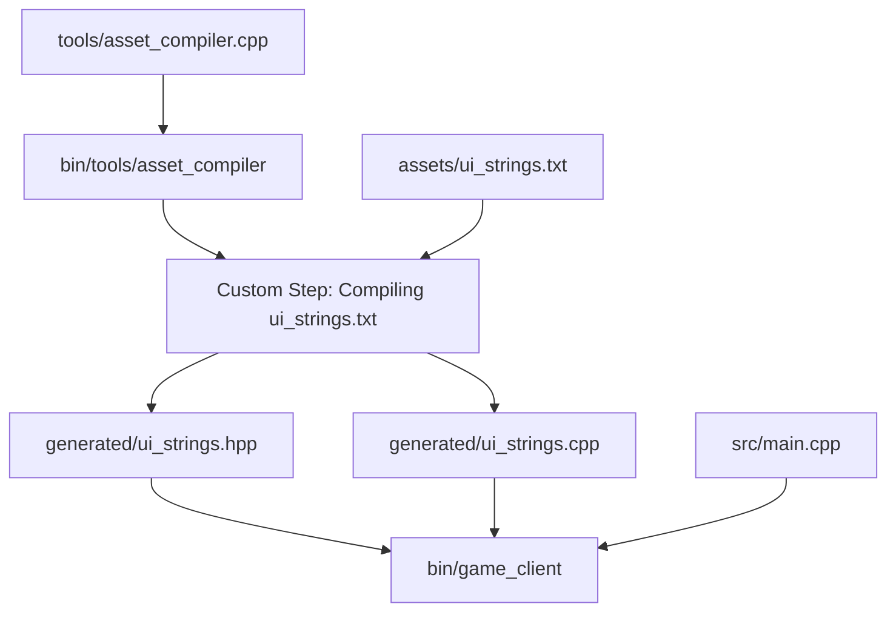

# 08 - Custom Code Generation DAG Pipeline (Master)

This master-level example demonstrates how to build a **multi-stage build pipeline** where custom tools are compiled, executed to generate C++ code, and the generated sources are subsequently compiled into the final application—all orchestrated within a single Directed Acyclic Graph (DAG) by `cxxgen`.

---

## What This Demonstrates
- Multi-stage pipeline bootstrapping: compiling a tool in-flight and running it during the same build.
- Using `b.add_custom_command` to declare custom build tasks with explicit inputs and outputs.
- Expressing custom DAG dependencies:
  - `codegen_step->depend_on(tool)` (tool must build before running codegen).
  - `client.depend_on(codegen_step)` (codegen must produce sources before client compiles).
- Content-hashed incremental builds: modifying `ui_strings.txt` automatically triggers the code generator and recompiles `game_client`.

---

## Pipeline Architecture



---

## Project Structure

```
08_custom_codegen_pipeline/
├── build.cpp                     # 3-stage DAG declaration
├── assets/
│   └── ui_strings.txt            # Raw text asset file
├── tools/
│   └── asset_compiler.cpp        # Code generation utility
├── src/
│   └── main.cpp                  # Final consumer application
└── README.md
```

---

## Step-by-Step Implementation

### Stage 1: Build the Tool
```cpp
auto &tool = b.add_executable({
    .name = "asset_compiler",
    .sources = {"tools/asset_compiler.cpp"},
    .output_dir = "bin/tools",
});
```

### Stage 2: Register Custom Command Step
```cpp
auto codegen_step = b.add_custom_command({
    .description = "Compiling assets/ui_strings.txt to C++ sources",
    .command = {tool_path, "assets/ui_strings.txt", "generated"},
    .inputs = {"assets/ui_strings.txt"},
    .outputs = {"generated/ui_strings.hpp", "generated/ui_strings.cpp"},
});
codegen_step->depend_on(tool);
```

### Stage 3: Build the Client
```cpp
auto &client = b.add_executable({
    .name = "game_client",
    .sources = {
        "src/main.cpp",
        "generated/ui_strings.cpp",
    },
    .include_dirs = {"generated"},
});
client.depend_on(codegen_step);
```

---

## How to Build and Run

### Run Build
```bash
cxxgen build
```

Observe the sequential progression through the stages:
1. `asset_compiler` is compiled and linked.
2. `asset_compiler` executes and writes `generated/ui_strings.hpp` & `ui_strings.cpp`.
3. `game_client` compiles `main.cpp` + `generated/ui_strings.cpp` and links the final executable.

### Run Game Client
```bash
cxxgen run game_client
```

Expected Output:
```
========================================
  Custom Codegen DAG Pipeline Demo      
========================================

Displaying Strings Generated at Build Time:
  [WELCOME]   : Welcome to the Antigravity Engine!
  [NEW GAME]  : Starting new game campaign...
  [LOAD GAME] : Loading saved game slot 1...
  [OPTIONS]   : Configuring display, audio, and controls.
  [QUIT]      : Thank you for playing! Exiting application...

[SUCCESS] DAG code generator pipeline completed successfully!
```
