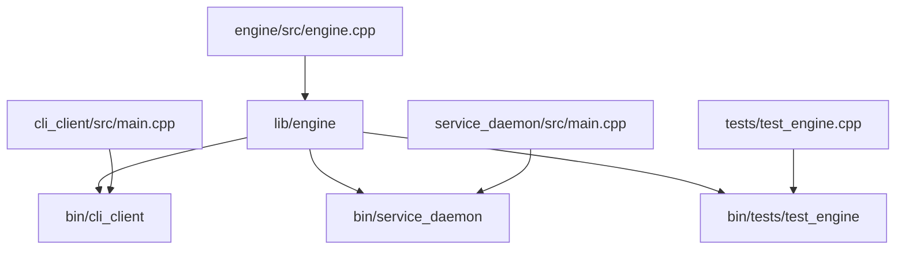

# 09 - Enterprise Monorepo Workspace (Master)

This example demonstrates how **`cxxgen`** scales to complex, real-world enterprise monorepos containing shared core libraries, multiple client applications, daemons/services, and integrated regression test suites.

---

## What This Demonstrates
- Monorepo workspace organization with multiple executables and libraries.
- Uniform compiler flags and target architectures configured across all targets.
- Target reuse: multiple executables and test suites depend on and link the same core engine library.
- Multi-artifact installation layout (`cxxgen build` prepares all deliverables at once).
- Granular target execution: `cxxgen run cli_client`, `cxxgen run service_daemon`, and `cxxgen test`.

---

## Project Structure

```
09_enterprise_workspace/
├── build.cpp                     # Unified workspace build configuration
├── engine/                       # Core shared framework
│   ├── include/engine.hpp
│   └── src/engine.cpp
├── cli_client/                   # User-facing CLI tool
│   └── src/main.cpp
├── service_daemon/               # Background daemon / service
│   └── src/main.cpp
├── tests/                        # Regression test suite
│   └── test_engine.cpp
└── README.md
```

---

## Workspace Architecture



---

## How to Build and Run

### Build All Deliverables
Compiles the core engine and both executables in parallel:
```bash
cxxgen build
```

### Run the CLI Client
```bash
cxxgen run cli_client -- "--status"
```

Expected Output:
```
[INFO] [CLI] Enterprise CLI utility launched
[INFO] [CLI-Tool] Context initialized and started.
[DEBUG] [CLI] Command argument received: --status
Enterprise Module [CLI-Tool] (v2.4.0-enterprise) - State: Running
[INFO] [CLI-Tool] Context stopped.
```

### Run the Service Daemon
```bash
cxxgen run service_daemon
```

Expected Output:
```
[INFO] [Daemon] Background service daemon initiating...
[INFO] [Background-Service] Context initialized and started.
[INFO] [Daemon] Simulating 1 heartbeat tick...
Enterprise Module [Background-Service] (v2.4.0-enterprise) - State: Running
[INFO] [Background-Service] Context stopped.
```

### Run All Workspace Tests
```bash
cxxgen test
```

Expected Output:
```
[RUNNING] Enterprise Engine Test Suite...
[INFO] [UnitTestCtx] Context initialized and started.
[INFO] [UnitTestCtx] Context stopped.
[PASS] All enterprise engine unit tests passed!
[cxxgen] All 1 test target(s) passed successfully.
```
