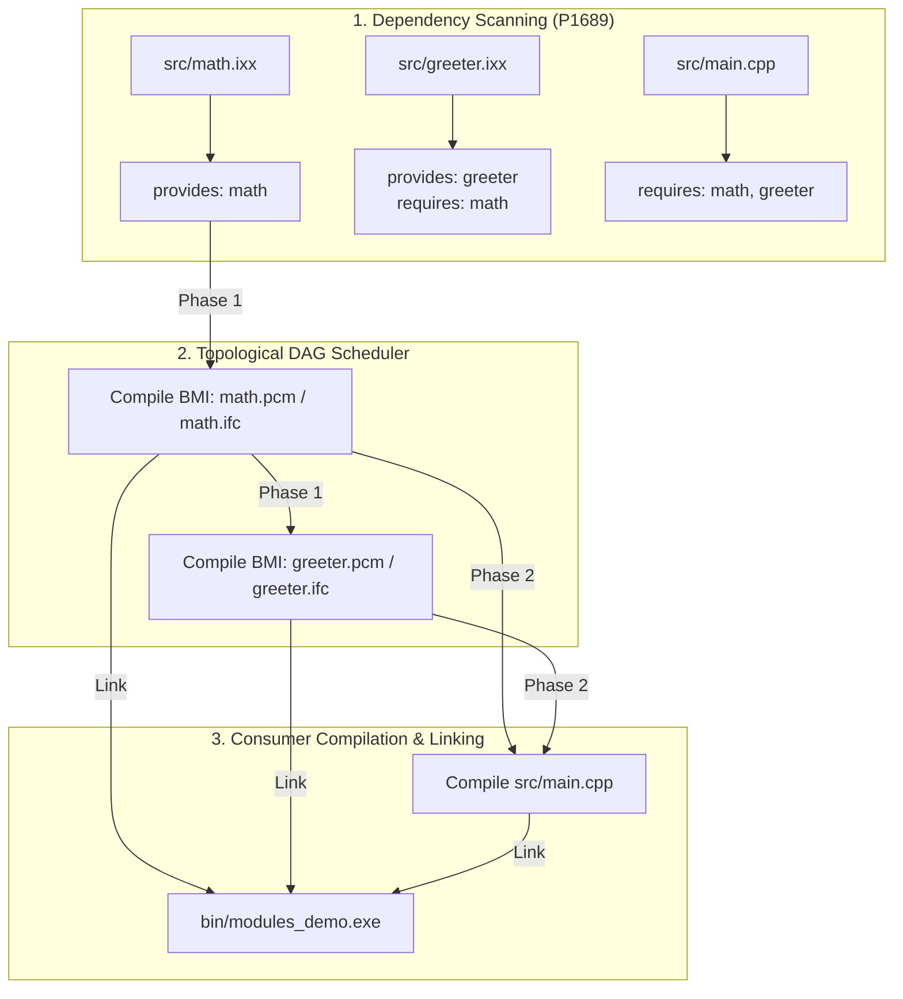

# Example 10: C++20 / C++23 Modules Architecture

This example demonstrates how **`cxxgen`** provides zero-configuration, first-class native support for **C++20 and C++23 Modules** (`export module`, `import`, and `import std;`).

---

## What are C++20 Modules?

For decades, C++ relied on textual `#include` preprocessor directives. This approach suffered from:
1. **Redundant Reparsing**: Every translation unit repeatedly parsed tens of thousands of lines of identical header code.
2. **Macro Leaks & Pollution**: Preprocessor macros defined in one header silently polluted and broke downstream code.
3. **Fragile Include Orders**: Subtle bugs caused by changing the order of `#include` statements.
4. **Slow Build Times**: Compilers spent 80%+ of build time parsing header text rather than optimizing code.

**C++20 Modules solve this completely:**
- **Encapsulated Interfaces**: Only explicitly `export`-ed symbols are visible to consumers.
- **Precompiled Binary Module Interfaces (BMI)**: Interfaces are compiled once into binary files (`.ifc` on MSVC, `.pcm` on Clang, `.gcm` on GCC).
- **Macro Isolation**: Macros do not leak across module boundaries.
- **Blazing Fast Compilation**: Importing a module is an instantaneous deserialization of AST metadata.

---

## How `cxxgen` Handles Modules

Building modular C++ has historically been notoriously difficult because compilers cannot compile translation units in parallel until their imported module interfaces (BMIs) are built.

**`cxxgen` makes this completely automatic:**



1. **Automatic P1689 Scanning**:
   `cxxgen` automatically scans all translation units using native P1689R5 scanners (`clang-scan-deps` / MSVC `/scanDependencies` / built-in regex fallback). You **never** need to manually specify module build order.
2. **Topological Two-Phase Compilation**:
   `cxxgen` sorts the module dependency graph, detects cyclic dependencies, generates BMIs in topological order (`math` &rarr; `greeter`), and feeds the compiled BMIs into dependent modules and consumers.
3. **Global BMI Caching**:
   BMIs are content-hashed with SHA-256 and cached globally across builds in `.cxxgen/cache/bmi/`.
4. **Standard Library Modules (`import std;`)**:
   Enabling `b.enable_std_module()` or `.enable_std_module = true` automatically locates your compiler's standard library module source (`std.ixx` / `std.cppm`) and precompiles it once into a cached BMI.

---

## Project Structure

```
10_cpp20_modules/
├── build.cpp            # cxxgen build script defining the executable target
├── README.md            # Architectural documentation & usage guide
└── src/
    ├── math.ixx         # Primary module interface 'math' (exports functions & structs)
    ├── greeter.ixx      # Module interface 'greeter' (imports 'math' & exports stats)
    └── main.cpp         # Consumer application (imports 'math' and 'greeter')
```

### Module Interface Unit: `src/math.ixx`

```cpp
export module math;

export namespace math {
    struct Vector2D {
        double x = 0.0;
        double y = 0.0;
        constexpr Vector2D(double x_, double y_) : x(x_), y(y_) {}
        constexpr Vector2D operator+(const Vector2D &other) const noexcept {
            return Vector2D(x + other.x, y + other.y);
        }
        constexpr double dot(const Vector2D &other) const noexcept {
            return (x * other.x) + (y * other.y);
        }
    };

    constexpr int add(int a, int b) noexcept { return a + b; }
    constexpr int multiply(int a, int b) noexcept { return a * b; }
    constexpr unsigned long long factorial(unsigned int n) noexcept {
        unsigned long long r = 1;
        for (unsigned int i = 2; i <= n; ++i) r *= i;
        return r;
    }
}
```

### Modular Dependency Unit: `src/greeter.ixx`

```cpp
export module greeter;

import math; // Imports math module interface

export namespace greeter {
    struct Stats {
        int calculations_performed = 0;
        int sum_result = 0;
    };

    Stats compute_stats(int a, int b) {
        Stats s;
        s.calculations_performed = 2;
        s.sum_result = math::add(a, b);
        return s;
    }
}
```

### Consumer Translation Unit: `src/main.cpp`

```cpp
#include <iostream>

import math;
import greeter;

int main() {
    int sum = math::add(25, 17);
    auto stats = greeter::compute_stats(100, 200);
    std::cout << "Sum: " << sum << ", Greeter: " << stats.sum_result << "\n";
    return 0;
}
```

### Build Definition: `build.cpp`

```cpp
#include "cxxgen.hpp"

void build(cxxgen::Builder &b) {
    auto target = b.standard_target_options();
    auto optimize = b.standard_optimize_options();

    auto &demo = b.add_executable({
        .name = "modules_demo",
        .sources = {
            "src/math.ixx",
            "src/greeter.ixx",
            "src/main.cpp",
        },
        .cpp_version = cxxgen::CppVersion::Cpp20,
        .target = target,
        .optimize = optimize.mode,
    });

    b.install_artifact(demo);
}

CXXGEN_MAIN(build)
```

---

## Building and Running

### Using the `cxxgen` CLI

```bash
# Build the modular executable
cxxgen build

# Run the compiled executable
cxxgen run modules_demo
```

### Expected Output

```
====================================================
   cxxgen: C++20 / C++23 Modules Architecture Demo   
====================================================

[math module]
  25 + 17       = 42
  6 * 7         = 42
  5!            = 120
  v1            = (3, 4)
  v2            = (1, 2)
  v1 + v2       = (4, 6)
  v1 . v2       = 11

[greeter module (imports math)]
  Calculations  = 2
  Sum Result    = 300

[SUCCESS] C++20 Modules executed cleanly via cxxgen!
```

---

## Key Takeaways

1. **No Manual Build Graph Ordering**: You list `.ixx`, `.cppm`, and `.cpp` files in `sources` in any order. `cxxgen` discovers import relationships automatically.
2. **Cross-Compiler Parity**: Works identically on **MSVC** (`cl.exe` `/interface` `/ifcOutput`), **LLVM Clang** (`clang++` `--precompile` `-fmodule-file=`), and **GCC** (`g++` `-fmodules-ts`).
3. **Seamless Interop with Legacy Headers**: Modules can coexist with legacy `#include` headers within the same project.
